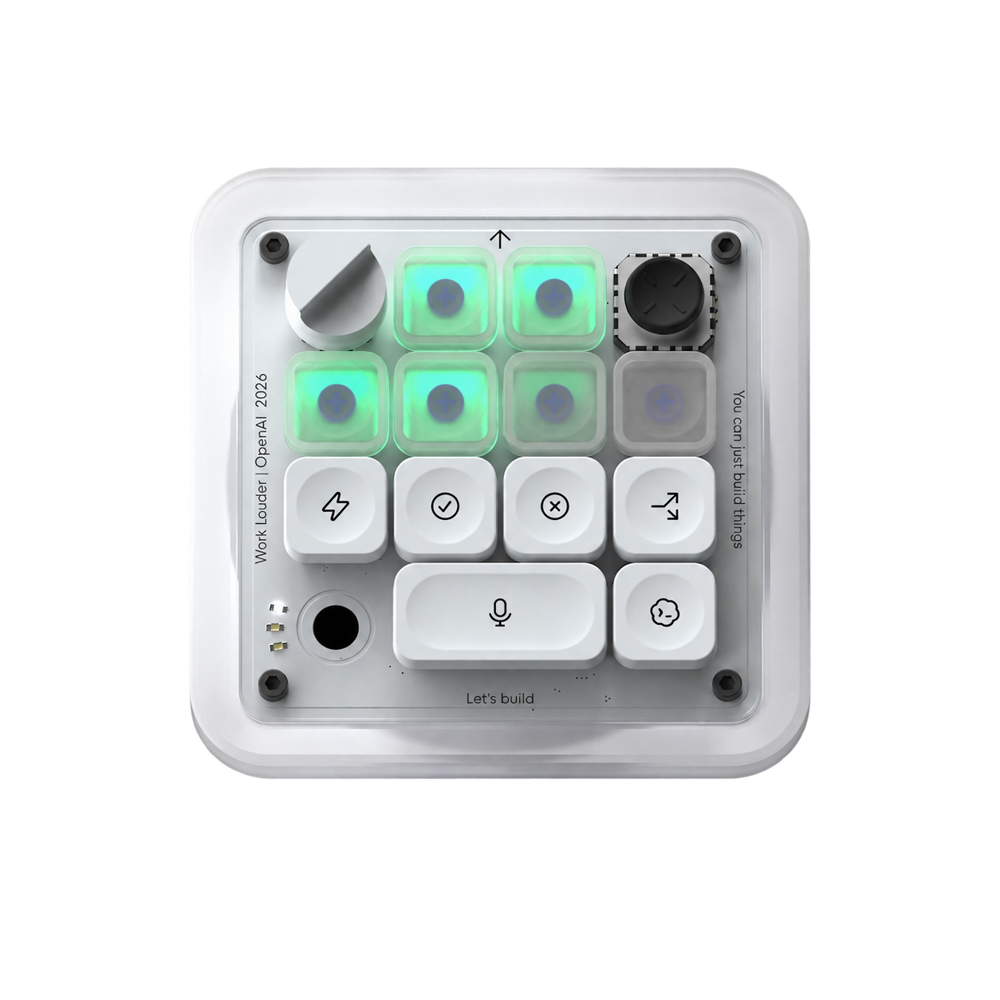
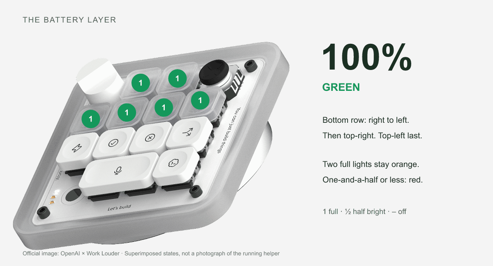

<p align="center"></p>

# Codex Micro Battery Display

**Six lights. One clear reading.**

An unofficial macOS companion that turns a dedicated layer on your Work Louder Codex Micro into a live battery gauge.

[**Download the beta**](https://github.com/corybytheway/codex-micro-battery/releases/tag/v0.1.0-beta.2) · [Install](#install) · [How the lights work](#how-the-lights-work) · [Remove it](#remove-it)

> **Public beta:** the six-light order and colors were physically verified on an Apple Silicon Mac with firmware 0.6.3. Beta 1's temporary install, copied background runtime, and removal were also verified on the real device, restoring its original configuration exactly. Beta 2's proportional fade passes automated tests; physical brightness confirmation is pending. Bluetooth, Intel Macs, and white underglow still need hardware verification. White underglow is opt-in and experimental.



Product imagery: [OpenAI × Work Louder](https://openai.com/supply/co-lab/work-louder/). The header visualizes the battery lights; the animation uses superimposed indicators. [Image credit and source](THIRD_PARTY_NOTICES.md).

## Install

You need **macOS**, **Node.js 22 or newer**, **Work Louder Input**, and a battery-equipped Codex Micro running **vendor firmware 0.6.3 or later**. Start with a USB connection.

1. Install [Work Louder Input](https://worklouder.cc/input) and [Node.js](https://nodejs.org/en/download) if you do not already have them.
2. Connect the Micro and **quit Input from its application menu**. The helper uses Input's installed HID driver; Input does not have to remain open.
3. [Download Micro-Battery-0.1.0-beta.2.zip](https://github.com/corybytheway/codex-micro-battery/releases/download/v0.1.0-beta.2/Micro-Battery-0.1.0-beta.2.zip), unzip it, and open **Install.command**. Review the displayed profile and new layer, then press Return to install.
4. Tap the Micro's layer sensor to select the new **Battery** layer. The installer tells you its number—usually layer 3 when you already have two layers.

The installer adds a new layer, saves a local backup, verifies the device readback, and enables a small login helper. Existing layers stay in place. A profile with six layers, unsupported layout, or insufficient spare channels is refused rather than overwritten.

You can reopen Input afterward. You can also move or delete the downloaded folder after installation: the runtime is copied to your own `~/Library/Application Support/Micro Battery/` folder.

**Upgrading from beta 1:** quit Input, run **Uninstall.command**, then **Install.command** from the new download. Backups are retained. Reapply any experimental underglow preference through Configure.command afterward.

Prefer Terminal?

```sh
git clone https://github.com/corybytheway/codex-micro-battery.git
cd codex-micro-battery
node bin/micro-battery.cjs install
```

To inspect the proposed change without writing anything, use `node bin/micro-battery.cjs install --dry-run`. Add `--profile ID` to select another profile, or `--input-app "/path/to/input.app"` for a custom Input installation.

## How the lights work

The two upper Agent lights fill first, followed by the four below. As the battery drains, **the bottom row empties right to left, then the top-right light, with top-left last**.

Each light represents one sixth of the battery. The active light's brightness matches the fraction left in its sixth, from 100% down to off. Earlier lights stay full; later lights are off. There is no halfway brightness switch.

| Visible reading | Color |
| --- | --- |
| Four to six illuminated lights | Green |
| Three lights, or the second light above 50% brightness | Orange |
| One full light plus a second at 50% brightness, or less | Red |

| Battery | Display | Color |
| --- | --- | --- |
| 100% | Six full lights | Green |
| 80% | Four full + one at 80% brightness | Green |
| 75% | Four full + one at 50% brightness | Green |
| 70% | Four full + one at 20% brightness | Green |
| 50% | Three full | Orange |
| 33⅓% | Two full | Orange |
| 33% | One full + one at 98% brightness | Orange |
| 25% | One full + one at 50% brightness | Red |
| 8% | One at 48% brightness | Red |
| 0% | All off | — |

The helper reads the Micro's actual battery every 15 seconds. **This is a Mac-connected gauge:** the Mac must be awake and connected to the Micro. When disconnected or asleep, the hardware may retain its last light state; it is not a standalone firmware battery meter.

Brightness follows each reported reading. If the Micro reports only whole battery percentages, a 1% battery change within a segment produces a six-percentage-point change in that light's brightness. LED output and perceived brightness may have their own granularity.

## Adjust it

Battery lights fade proportionally without configuration. Open **Configure.command** for the ambient-light preference, or use:

```sh
# Opt into experimental white underglow at 70% brightness.
node bin/micro-battery.cjs configure --underglow white --brightness 70

# Explicitly turn ambient light off on the Battery layer.
node bin/micro-battery.cjs configure --underglow off

# Return ambient-light control to the usual vendor behavior.
node bin/micro-battery.cjs configure --underglow inherit
```

Settings are picked up within one polling interval. The former fixed `--dim` option is no longer used. White/off underglow commands use a vendor ambient-light path whose visual behavior is still being tested; `inherit` is the default. Normal Codex lighting resumes according to the Codex host's own refresh behavior when you leave the Battery layer.

**Why does Input say to edit this layer in ChatGPT?** The gauge uses vendor Agent-light assignments. Input recognizes those assignments and hides the layer editor, even when Codex is idle. Use this package's Configure command for the gauge, and Input for your other layers.

## Start, stop, and status

The matching `.command` files work with a double-click. Terminal equivalents:

```sh
node bin/micro-battery.cjs status
node bin/micro-battery.cjs stop
node bin/micro-battery.cjs start
```

`stop` also disables login startup; `start` enables it again. Reconnection is automatic while the service is running. No firmware flashing, app patching, API key, or npm dependencies are required.

## Remove it

Connect the Micro, quit Input, and open **Uninstall.command**. It removes only the managed Battery layer, preserves current other layers, stops the helper, and disables login startup. Backups are retained locally. If the managed layer has been edited by another tool, uninstall refuses to overwrite those edits.

```sh
node bin/micro-battery.cjs uninstall --dry-run
node bin/micro-battery.cjs uninstall
```

If installation was interrupted, the local recovery journal and original keymap backup remain available. See [troubleshooting](docs/troubleshooting.md).

## Compatibility and verification

| Item | Status |
| --- | --- |
| Apple Silicon, USB, firmware 0.6.3 | Gauge visually verified on a real Micro |
| macOS 27.2, Node 22.9.0, Input 1.0.2 | Development hardware environment |
| Install/service/uninstall lifecycle | Beta 1 real hardware round-trip verified; current simulated regression tests |
| Charge thresholds, order, proportional brightness | Explicit examples + 10,001 charge-conservation/monotonicity/contiguity checks |
| Proportional fade on hardware (beta 2) | [Firmware acknowledged 20% and 80% brightness](docs/proportional-brightness-verification.json); physical brightness confirmation pending |
| White underglow | Experimental; physical confirmation pending |
| Bluetooth / Intel Mac | Code paths included; hardware verification pending |
| Windows / Linux | Hardware service not supported in this release |

## Privacy and implementation

The runtime makes no network requests and includes no telemetry. It discards key/joystick notifications. Configuration backups and logs remain in your user Library folder; do not upload your full keymap or backups in an issue because they can contain personal shortcuts and commands.

The gauge allocates six unused firmware Agent channels from 6–19. Codex's normal six channels, 0–5, are reserved. Only interface facts are implemented here: no Work Louder firmware, SDK code, HID binaries, app archives, or personal device configuration are redistributed.

Read the [implementation and protocol notes](docs/implementation.md), [visual notes](docs/visuals.md), and [contributing guide](CONTRIBUTING.md). Run `npm test`; no `npm install` is needed.

Created by **Cory McCabe**. [MIT licensed](LICENSE). This is an independent project, not affiliated with or endorsed by OpenAI or Work Louder. Product names identify compatible hardware.
